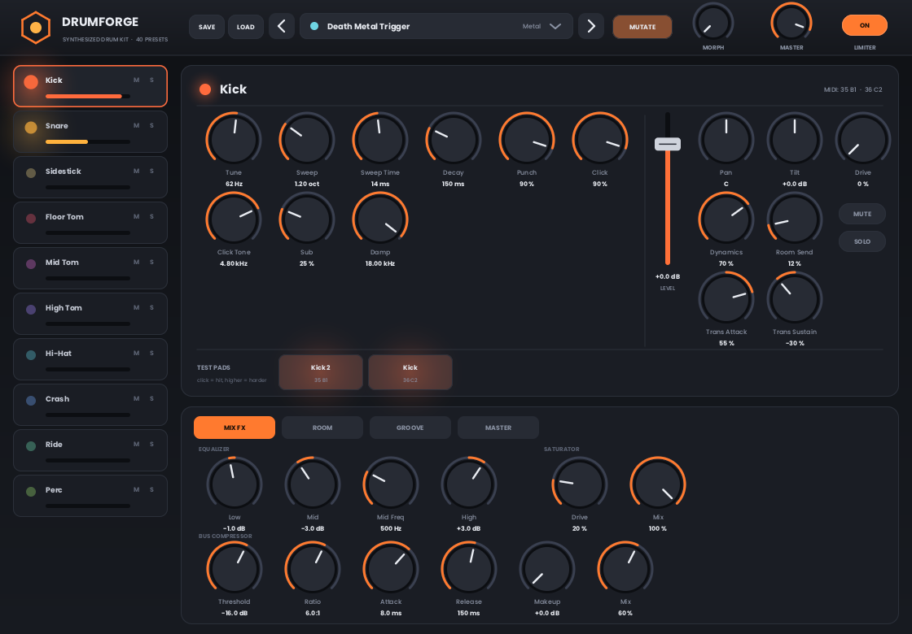
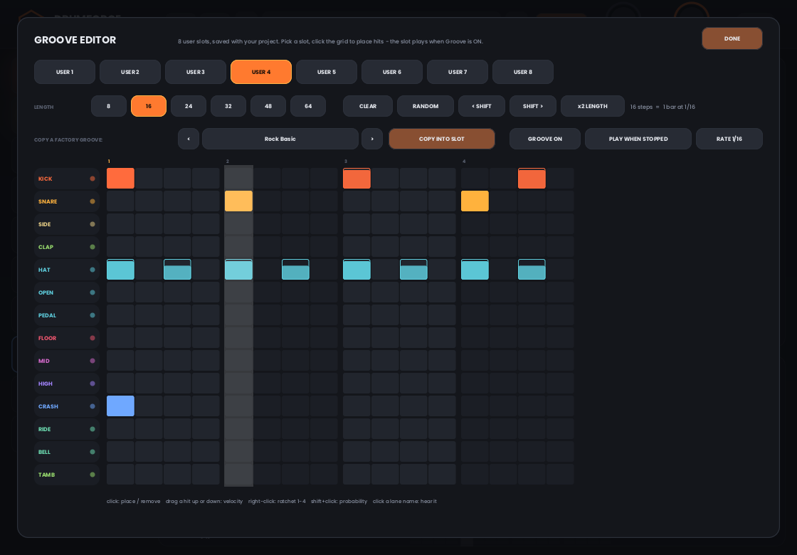
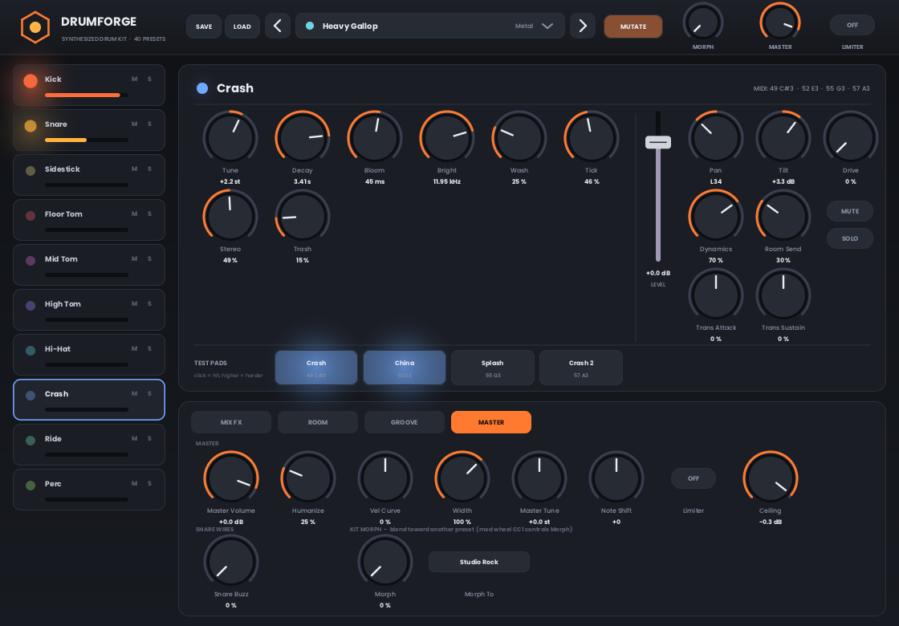

# DrumForge

A fully synthesised, highly configurable **VST3 drum instrument** for Windows (with Linux/macOS builds of the same engine). No samples: every kick, snare, tom, hat and cymbal is generated by the code, so it loads instantly, weighs about 1.4 MB, and every piece can be reshaped.

## Download

**[Releases page](../../releases)** has zips for Windows x64, Linux x64 and macOS (universal). A Windows build is also kept in the repo at [`prebuilt/DrumForge-win64.zip`](prebuilt/DrumForge-win64.zip).

### Install (Windows)

1. Unzip `DrumForge-win64.zip`.
2. Copy the whole **`DrumForge.vst3`** folder to `C:\Program Files\Common Files\VST3\` (needs admin rights).
3. Rescan plugins in your DAW and load **DrumForge** as an instrument (64-bit hosts only).
4. Click a preset, hit the **test pads** under each drum, or play MIDI. Done.

The `.vst3` file inside is the DLL. If Windows complains about a missing runtime, install the Microsoft UCRT / Visual C++ redistributable.

> **Honest status:** the Windows DLL was cross-compiled and verified with Steinberg's VST3 validator (on the Linux build of the same code), plus automated engine, GUI-logic, groove-loop and fuzz tests. It has **not** yet been run inside a real Windows DAW by its author. If something misbehaves, please open an issue with your DAW, its version, the preset and the steps.

### Install (Linux / macOS)

* **Linux:** copy `DrumForge.vst3` to `~/.vst3/` and rescan.
* **macOS:** copy `DrumForge.vst3` to `~/Library/Audio/Plug-Ins/VST3/` and rescan. The build is unsigned; if macOS blocks it run `xattr -cr ~/Library/Audio/Plug-Ins/VST3/DrumForge.vst3`.
* Linux and macOS use the host's generic parameter UI (the custom editor is Windows-only for now). They compile and pass CI but have not been run in a real DAW.

## What it does

* **10 kit pieces:** Kick, Snare, Sidestick, Floor / Mid / High Tom, Hi-Hat (closed / pedal / open), Crash, Ride, Perc (clap, cowbell, tambourine, etc.), 220+ parameters in total.
* **40 factory presets** across rock, metal, jazz, electronic, lo-fi and more.
* **Test pads** on every instrument page, with velocity from where you click.
* **Groove player:** 28 factory patterns, loop-aware (no double hits or stray cymbals when the host loops), and **it never adds crashes on its own**.
* **Groove Editor:** 8 user slots, 14 lanes, up to 64 steps, per-step velocity, ratchets (1-4) and probability. Copy any factory groove into a slot and edit it. Slots are saved with your project.
* **Kit Morph:** the mod wheel (CC1) or the Morph knob blends the current kit toward another preset.
* **Mutate:** randomises every instrument by an equal amount and auditions the currently selected one.
* **Save / Load kits:** store your own drum configs as `.dfkit` text files (default folder `Documents\DrumForge Kits`).
* **Per-piece transient shaper**, **snare sympathetic buzz**, drive, tilt, pan, room send, mute / solo on each piece.
* **Master section:** 3-band EQ, saturator, bus compressor, 8-line FDN room reverb and a look-ahead limiter.
* **7 stereo stem outputs** (Kick, Snare, Toms, Hats, Cymbals, Perc, Room) for mixing in your DAW.

| Groove Editor | Master / FX |
|---|---|
|  |  |

## Documentation

Full manual with a worked example, all presets, groove list and the complete parameter reference: **[docs/USER_GUIDE.md](docs/USER_GUIDE.md)**.

## Platforms

| Platform | Audio engine | Editor GUI |
|---|---|---|
| Windows x64 | yes (pre-built) | yes (built-in, DPI aware) |
| Linux x64 | yes (build from source) | host's generic parameter UI |
| macOS | yes (build from source) | host's generic parameter UI |

## Build from source

The Steinberg VST3 SDK is not bundled. Clone it first:

    git clone --recurse-submodules https://github.com/steinbergmedia/vst3sdk.git third_party/vst3sdk

**Windows:** install MSYS2 MinGW-w64 (`pacman -S mingw-w64-ucrt-x86_64-gcc`) or Visual Studio with the C++ workload, then run `build_windows.bat` (add `install` as Administrator to copy it into the VST3 folder). Output: `build\win\DrumForge.vst3\Contents\x86_64-win\DrumForge.vst3`.

**Any platform (CMake):**

    cmake -S . -B build-x -DCMAKE_BUILD_TYPE=Release
    cmake --build build-x --target DrumForge

Output is in `build-x/raw/` and `build-x/bundle/`.

**Cross-compile the Windows DLL from Linux/macOS (zig):**

    pip install ziglang
    cmake -S . -B build-win -G Ninja -DCMAKE_TOOLCHAIN_FILE=cmake/toolchain-zig-win64.cmake
    cmake --build build-win --target DrumForge

GitHub Actions (`.github/workflows/build.yml`) builds Windows, Linux and macOS on every push.

**Offline renderer:** `cmake --build build-x --target df_render` builds a command-line tool that renders presets and grooves to WAV with no host.

## Layout

    src/dsp       filters, resonators, noise, smoothing
    src/engine    parameters, voices, FX, grooves, presets (no SDK dependency)
    src/plugin    VST3 processor / controller / factory, Win32 editor shell
    src/gui       software-rendered editor (platform independent)
    tools         renderer, analysis, fuzz and test programs
    docs          user guide and screenshots
    prebuilt      Windows VST3 zip

## Known limits

* Not tested in a real Windows DAW by the author yet (see above).
* GUI is Windows-only for now.
* Synthesised, not sampled: no round-robins or mic-bleed modelling.
* Groove Editor has fixed slot names and no MIDI import / export yet.

## Licence

Source is MIT (see [LICENSE](LICENSE)). VST3 SDK is MIT (Steinberg; "VST" is a Steinberg trademark), Poppins font is SIL OFL 1.1, stb_truetype is public domain. Details in [LICENSE-NOTICES.md](LICENSE-NOTICES.md).
